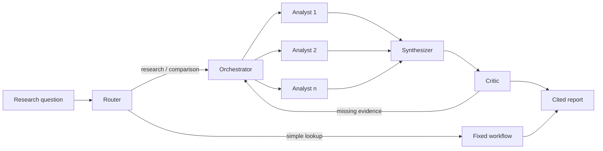

# Financial Research Agent

A multi-agent research assistant for A-share listed companies. Ask a research question; the system gathers evidence from annual reports, announcements and structured financial data, computes every figure in a sandbox, and returns a report in which every claim links back to its source.

> **Status:** under active development — currently at milestone **M0** (engineering foundation and evaluation framework). See [Roadmap](#roadmap).

[中文简介](#中文简介)

## Why it is different

- **Every claim is cited.** Conclusions are bound to the exact source passage; unsourced claims never reach the report.
- **Numbers never come from the model.** Figures are fetched from structured data and computed as code in an isolated sandbox, then checked by code against tool results.
- **Evaluation first.** A versioned evaluation set with a CI gate measures accuracy, citation quality, cost and latency on every change. Design choices are kept only when the data supports them.
- **Built to survive failure.** Long tasks checkpoint after every step and resume after a crash without repeating side effects.
- **Controlled.** Role-based access to tools and documents, an append-only audit log, prompt-injection defences, and human-in-the-loop approval for sensitive steps.

## Architecture

| Role | What it does |
|---|---|
| Router | Classifies intent and complexity; sends simple lookups to a fixed workflow |
| Orchestrator | Splits a question into sub-tasks by company and research dimension, including a dedicated counter-evidence task |
| Analyst | The only true agent: retrieves documents, queries data and runs calculations for one sub-task, in an isolated context |
| Synthesizer | Assembles findings into a report, citing only evidence the Analysts found |
| Critic | Verifies citations, numbers and accounting identities; sends gaps back for follow-up |

## Tech stack

Python · FastAPI · LangGraph · PostgreSQL + pgvector · Redis Streams · React + TypeScript · OpenTelemetry · Docker Compose · Claude and OpenAI models behind a provider-neutral gateway

## Documentation

| Document | English | 中文 |
|---|---|---|
| Architecture | [ARCHITECTURE.md](docs/ARCHITECTURE.md) | [ARCHITECTURE.zh-CN.md](docs/ARCHITECTURE.zh-CN.md) |
| Technical decision handbook | [TECH_DECISIONS.md](docs/TECH_DECISIONS.md) | [TECH_DECISIONS.zh-CN.md](docs/TECH_DECISIONS.zh-CN.md) |
| Deployment guide | [DEPLOYMENT.md](docs/DEPLOYMENT.md) | [DEPLOYMENT.zh-CN.md](docs/DEPLOYMENT.zh-CN.md) |

## Roadmap

| Milestone | Scope | Status |
|---|---|---|
| M0 | Engineering foundation, data ingestion, evaluation harness, CI | In progress |
| M1 | Retrieval pipeline (hybrid search, reranking, citations), fixed workflow, calculation sandbox | Planned |
| M2 | Multi-agent orchestration, durable execution, single- vs multi-agent experiments | Planned |
| M3 | Security and governance, tracing, web UI, MCP server, public demo | Planned |
| M4 | Memory, improvement flywheel, real-user trials | Planned |
| M5 | Optional exploration | Planned |

Setup instructions will be added once M0 is in place; the target deployment is described in the [deployment guide](docs/DEPLOYMENT.md).

## Scope

This project is for investment research and analysis only. It gives no buy/sell ratings or price predictions, places no trades, and does not provide investment advice.

---

## 中文简介

面向 A 股上市公司的投研 Agent。用户提出研究问题，系统从年报、公告和结构化财务数据中取证，所有数字在沙箱中用代码计算，最终输出每条结论都能追溯到原文出处的研究报告。

工程上按企业级标准实现：评测驱动（每次改动都用评测集度量）、全链路追踪、断点恢复、权限与审计、人工审批。

项目正在开发中，当前处于 M0 阶段。详细设计见[架构文档](docs/ARCHITECTURE.zh-CN.md)、[技术决策手册](docs/TECH_DECISIONS.zh-CN.md)和[部署文档](docs/DEPLOYMENT.zh-CN.md)。

本项目仅用于投资研究与分析，不提供买卖评级、价格预测或投资建议。
